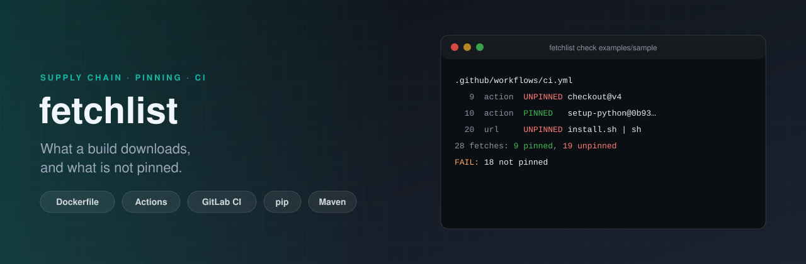

<p align="center"></p>

# fetchlist

[](https://github.com/ErenOzgu/fetchlist/actions/workflows/ci.yml)


**What does this build download, and is any of it pinned?** `fetchlist` reads the files that say how a project is built
(Dockerfiles, GitHub Actions workflows, GitLab CI files, shell scripts and Makefiles, `requirements.txt`, `pom.xml`),
lists every image, action, URL, package and include they pull in from outside the repository, and says for each one
whether its content is fixed or can change without the repository changing. The same list answers a second question:
which hosts, registries and packages an offline mirror or a firewall allowlist has to hold for the build to run.

## Why

A tag such as `python:3.12-slim` or `actions/checkout@v4` is a promise that can be broken: whoever controls the
registry or the repository can move it, and nothing in your repository changes when they do. A `curl ... | sh` runs
whatever the server sends today. Vulnerability scanners say what is wrong with what you have; this asks the question
before, what you are going to get. It is cheap to answer (every fact is already in the build files) and expensive
to find out afterwards.

The second question comes from the other side of the same list. A build in a network that allows only some hosts, or
one that must run from an internal mirror, fails on the first thing nobody wrote down. `fetchlist mirror` writes it
down.

## Try it

Python 3.11 or newer, no dependencies.

```sh
pip install git+https://github.com/ErenOzgu/fetchlist
fetchlist check .                # exit 1 if something is not pinned
fetchlist scan .                 # the full list, pinned or not
fetchlist mirror . --what hosts  # what the build has to reach
```

Or run it from a checkout with `python -m fetchlist check .`.

## What it reads

| File | What it finds |
|---|---|
| `Dockerfile`, `Containerfile` | `FROM` and `COPY --from` images (stages and `scratch` are not downloads, `ARG` defaults are filled in), `ADD` from a URL, and everything `RUN` downloads |
| `.github/workflows/*.yml`, `action.yml` | `uses:` (actions, reusable workflows, `docker://`), `container:` and `services:` images, `run:` steps |
| `.gitlab-ci.yml` | `image:`, `services:`, `include:` (remote, project, template, component), `script:`, `before_script:`, `after_script:` |
| `docker-compose.yml`, `compose.yml` | `image:` |
| `*.sh`, `Makefile`, `*.mk` | the same shell commands as `RUN` and `run:` |
| `requirements*.txt`, `constraints*.txt` | each requirement, direct references, VCS URLs, the index in use |
| `pom.xml` | dependencies, plugins, extensions and the parent, repositories |

In shell text it knows `curl` and `wget` (including `| sh`, `sh -c "$(curl ...)"` and `bash <(curl ...)`),
`pip install`, `npm install` and `npx`, `go install`, `docker pull` and `docker run`, and `git clone`. Variables the
file defines for itself (`env:`, `ARG`, `export`, Makefile assignments) are filled in, so `docker run "${IMG}"` is
judged by the digest in `IMG`.

## Statuses

| Status | Meaning | Example |
|---|---|---|
| `pinned` | the content is fixed | an image with `@sha256:`, an action at a 40-character commit, `pkg==1.2.3`, a download whose literal sha256 is checked in the same step, a URL that names a commit |
| `verified` | a checksum or signature check is in the same step, but it cannot be seen where the expected value comes from | `curl ... && sha256sum -c sums.txt`, where `sums.txt` was downloaded from the same place |
| `unpinned` | the content can change without a commit in this repository | a tag, a branch, `:latest`, `pkg>=2`, `@latest`, `curl ... \| sh`, `ADD` from a URL without `--checksum`, a plain `http://` or `curl -k` download |
| `unresolved` | the reference holds a variable that this file does not define | `docker run "$IMAGE"` where `IMAGE` comes from somewhere else |
| `info` | not graded, recorded for `mirror` | the package index a requirements file installs from |

`check` fails on `unpinned`. `--strict` also fails on `verified` and `unresolved`.

## Example

`examples/sample` is a small project that is unpinned on purpose (and has one allowance, below). `fetchlist check
examples/sample` prints what is wrong with it and exits 1:

<details><summary>fetchlist check examples/sample</summary>

<!-- example: examples/sample.check.txt -->
```text
.github/workflows/ci.yml
     9  action  UNPINNED   actions/checkout@v4
                             the tag v4 can be moved to another commit
    11  package UNPINNED   ruff
                             any version matches
    20  url     UNPINNED   https://get.example.com/install.sh
                             piped into a shell, so nothing can check what runs
.gitlab-ci.yml
     2  include UNPINNED   https://example.com/ci/templates/base.yml
                             the file at this URL can change
     3  include UNPINNED   platform/pipelines@main
                             main is a branch or tag and can move
     8  image   UNPINNED   maven:3.9-eclipse-temurin-21
                             the tag :3.9-eclipse-temurin-21 can be pushed again to different content
    10  image   UNPINNED   postgres:16
                             the tag :16 can be pushed again to different content
Dockerfile
     1  image   UNPINNED   golang:1.23
                             the tag :1.23 can be pushed again to different content
     2  package UNPINNED   golang.org/x/tools/cmd/goimports@latest
                             @latest is not a release version
     3  url     UNPINNED   https://example.com/tools/lint-1.4.0.tar.gz
                             nothing in the same step checks what was downloaded
     7  image   UNPINNED   ghcr.io/example/helper:2.1
                             the tag :2.1 can be pushed again to different content
     8  url     UNPINNED   https://example.com/data/dataset.csv
                             ADD from a URL without --checksum
     9  package UNPINNED   gunicorn
                             any version matches
requirements.txt
     2  package UNPINNED   requests>=2.31
                             '>=2.31' is a range, not one version
     3  package UNPINNED   gunicorn
                             any version matches
scripts/install.sh
     5  url     UNPINNED   https://example.com/releases/tool-1.9.2.tar.gz
                             nothing in the same step checks what was downloaded
service/pom.xml
    15  package UNPINNED   com.example:internal-lib:[1.0,2.0)
                             [1.0,2.0) is a range, not one version
    22  package UNPINNED   org.apache.maven.plugins:maven-jar-plugin
                             no version here and none in pluginManagement; Maven picks one, unless a parent pom sets it

28 fetches in 6 files: 9 pinned, 19 unpinned (1 allowed)
FAIL: 18 not pinned
```

</details>

`fetchlist mirror examples/sample` lists the hosts the build has to reach:

<!-- example: examples/sample.mirror.txt -->
```text
docker.io
example.com
get.example.com
ghcr.io
github.com
proxy.golang.org
pypi.org
registry.npmjs.org
repo.maven.apache.org
```

`--what` also takes `images`, `actions`, `packages`, `urls` and `all`, and `--format json` makes any of them
machine-readable. These outputs are regenerated in CI by `examples/generate.sh --check`, so they cannot drift from what
the tool prints.

## The commands

| Command | What it does | Exit status |
|---|---|---|
| `fetchlist scan [ROOT]` | every download, with its status and the reason; `--format text\|json\|markdown` | 0 |
| `fetchlist check [ROOT]` | only what fails; `--format text\|json\|github` (annotations on the lines), `--strict` | 0 all pinned or allowed, 1 something is not, 2 a file could not be analysed or the configuration is wrong |
| `fetchlist mirror [ROOT]` | hosts, images, actions, packages or URLs the build reaches | 0 |

## Allowances

Some things are unpinned on purpose: a throw-away container in a smoke test, a scan that is meant to fail on an old
image. They go in `.fetchlist.toml` at the root, each with its reason:

```toml
exclude = ["examples/**"]            # files to leave out

[[allow]]
file = ".github/workflows/ci.yml"    # a glob, relative to the root
ref  = "alpine:3.20"                 # exactly as `scan` prints it
reason = "a throw-away container for a smoke test"
```

An allowance without a reason is an error, and **an allowance that covers nothing is an error too**: when the thing it
excused is pinned or removed, `check` tells you to delete the allowance, so the list cannot rot into a pile of old
exceptions.

## How it decides

- **A step is the unit.** A download counts as checked when a checksum or signature command (`sha256sum -c`,
  `shasum -c`, `gpg --verify`, `cosign verify`, `minisign -V`, `gh attestation verify`) is in the same step, the same
  `RUN`, the same GitLab `script` entry or the same blank-line-separated paragraph of a script. With a 64-digit hex
  literal in that step (or in a variable that holds one) it is `pinned`; without, `verified`.
- **Piped into a shell is never fine.** `curl ... | sh` stays `unpinned` even if a checksum command appears nearby,
  because nothing connects the check to what runs.
- **Local things are not downloads.** Loopback URLs, `pip install .`, `pip install ./dist/x.whl`, `go install ./...`,
  local actions (`./`) and images the same file builds with `docker build -t` are left out.
- **A file is read, not run.** A `pom.xml` with a `DOCTYPE` or `ENTITY` is refused instead of expanded, symlinks are not
  followed, files over 2 MB are skipped, and `check` exits 2 when it had to skip something, so a file it could not read
  never turns into a pass.

## Limits

- **It reads lines, not syntax trees.** CI files are scanned with indentation rules instead of a YAML parser (flow
  mappings, anchors and multi-document files are not understood), and shell is split on `&&`, `;` and `|` instead of
  parsed. It is built to be right on ordinary files and to say `unresolved` rather than guess.
- **A check in the step is not a check of the file.** The "same step" rule shows that a verification exists, not that it
  covers the download next to it.
- **Not covered yet:** `apt`, `apk`, `yum` and `brew` installs, `pyproject.toml`, `package.json`, lock files,
  Gradle, Terraform providers and modules, Helm charts, `.pre-commit-config.yaml`. See the [roadmap](ROADMAP.md).
- **It does not look anything up.** It does not check that a digest exists, that a tag still points where it did, or
  that a pinned version has no known vulnerability. Pair it with a scanner such as OSV-Scanner or Trivy.
- **`mirror` lists names, not everything on the wire.** A registry can send you to other hosts for the layers, and a
  package index to a CDN; those are not in the list. Variables in a URL leave a fetch with no host, and `mirror` says
  how many.

## How it was checked

- 225 tests: every rule above, each scanner on real-looking input, the command line (exit codes, formats, the
  configuration), and a mutation of the sample files, 300 per file, that must never crash a scanner and must always
  point at a line that exists.
- **A mutation check, once and by hand.** 112 single-line changes to the lines that decide a status (the pinning
  rules, the regexes for `curl | sh` and checksums, the allowance matching, the exit codes); after each change the
  suite was run and had to fail. The first run left 31 of them alive (and four more did not match my own typo-ridden patterns); those became
  tests, or were removed where the code turned out to be redundant. The last run killed all 112. It is not in CI and not exhaustive.
- CI runs the tests on Python 3.11 to 3.13, lints with `ruff`, `shellcheck` and `actionlint`, installs the built wheel
  into a clean environment, and runs `fetchlist check . --strict` on **this repository**, whose own workflows are pinned by
  commit SHA.

## Layout

```text
fetchlist/        the package: one scanner per file type, shell.py for the commands inside them
examples/sample   a project that is unpinned on purpose, and the committed outputs for it
tests/            unit tests per scanner, the command line, discovery, robustness
.github/          CI, a release workflow, Dependabot
```

## More

[Design notes](docs/design-notes.md), [CHANGELOG](CHANGELOG.md), [ROADMAP](ROADMAP.md).

## License

MIT, see [LICENSE](LICENSE).
